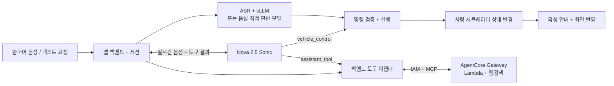

# 온 · 차량 음성 랩

한국어 차량 음성 비서의 자체 서빙 모델과 Nova 2.5 Sonic을 비교하는 **차량 기능 시뮬레이터**입니다. [English README](README.md) · [배포 안내](docs/DEPLOYMENT.md) · [도구·구조 설명](docs/ARCHITECTURE.md)

음성·텍스트·음성 파일로 운전석/조수석 온도, 공조, 김서림 제거, 열선, 미디어 상태, 모의 목적지를 변경합니다. 서버가 명령을 검증한 뒤 상태를 적용합니다. 정정·되돌리기·현재 상태 질문도 지원합니다. 실제 차량, CAN, 센서, 실내 열역학은 연결하지 않았습니다. 차량 카드의 미디어·내비 상태는 모의 상태이며, 별도 라디오 플레이어에서는 실제 방송을 재생하고 외부 도구로 교통 미반영 경로를 조회합니다.

[공유 데모 열기](https://dys3pnz3y08gk.cloudfront.net/?lang=ko) · [테스트 시나리오](#바로-따라-하는-테스트-시나리오) · [벤치마크 설명](#벤치마크는-어떻게-했나요)

## 작은 GPU 배포와 서빙 비용 실험

서울 **L4 / g6.xlarge** 한 대에 별도 배포해 Qwen 4B BF16/NF4와 Phi-4 mini를 평가합니다. 빠른 후보로 단일 워커, 같은 GPU의 Docker 복제본 2개, vLLM 연속 배치를 비교합니다. 기존 공유 데모도 계속 사용할 수 있습니다. [L4 차량 데모](https://d3q7tlfor72b22.cloudfront.net/) · [비용 계산기와 실측 결과](https://d3q7tlfor72b22.cloudfront.net/costs.html) · [결과·손익분기점·스케일 방법](docs/GPU_RIGHTSIZING.ko.md). [남는 자원과 4비트 소형 서버 추가 검증](docs/GPU_HEADROOM.ko.md).

## 바로 따라 하는 테스트 시나리오

차량 패널 안 **차량 도우미**에서 날씨·웹검색·라디오·관광지 해설·공휴일·환율·일출/일몰·경로·타이머·메모·비용 계산을 실행할 수 있습니다. `재즈 라디오 틀어줘`, `경복궁 설명해줘`, `100달러 원화로 계산해줘`, `10분 타이머 맞춰줘`, `충전비 20kWh, kWh당 350원 계산해줘`처럼 말하거나 버튼을 누르세요. 주변 장소는 공개 공급자 오류가 반복되어 기본 제외했습니다.

외부 조회는 **도쿄 AgentCore Gateway MCP + Lambda + AWS 내장 웹검색**, 차량 제어·타이머·메모·계산은 기존 백엔드에서 실행합니다. 자체 서빙 경로의 새 정보 요청은 ASR 뒤 앱 라우터가 분기하고, Sonic은 네이티브 `assistant_tool`을 호출합니다. 별도 API 키 발급은 필요 없습니다. [도구별 실측·제약](docs/ASSISTANT_TOOLS.md)은 기존 차량 모델 점수와 별도로 기록합니다.

기본 **자체 서빙 · STT → sLLM → TTS / Qwen3.5-4B NF4 / Whisper / Polly**를 선택합니다. **한국어 샘플 음성** 버튼을 누르면 마이크 권한 없이 “조수석 온도 25도” 요청을 실행하고, 화면의 온도 변경과 한국어 음성 응답을 확인할 수 있습니다.

직접 테스트하려면 **마이크 시작**을 누르고 아래 문장을 말하거나 텍스트 입력창에 입력합니다. 답변이 끝나면 다음 요청을 보내세요. 처음 모델을 바꾸면 로딩 시간이 추가됩니다. 모델을 바꿔 같은 시나리오를 반복하면 인식·명령 실행·응답 속도의 차이를 비교할 수 있습니다.

### 연속 대화 3단계

**차량 초기화**를 한 번 누른 뒤 순서대로 실행합니다. 직전 좌석 기억, 정정, 되돌리기를 확인하는 시나리오입니다.

| 순서 | 말하거나 입력할 문장 | 기대 결과 |
| --- | --- | --- |
| 1. 좌석 지정 | `조수석 온도를 25도로 맞춰줘.` | 조수석 25도, 운전석 22도 유지 |
| 2. 정정 | `아니, 24도로 맞춰줘.` | 직전 대상인 조수석만 24도로 변경 |
| 3. 되돌리기 | `방금 설정 되돌려줘.` | 정정 전 상태인 조수석 25도로 복구 |

### 다른 기능도 확인해 보세요

**아래 각 행을 테스트하기 전에는 차량 초기화**를 눌러 같은 시작 상태에서 비교합니다. 아래는 기대 동작이며 모든 모델이 통과한다는 뜻은 아닙니다. 실패 사례도 모델 비교 결과에 포함됩니다.

| 기능 | 테스트 문장 | 확인할 결과 |
| --- | --- | --- |
| 상대 온도 | `운전석 온도를 1도 올려줘.` | 운전석 22→23도, 조수석 22도 유지 |
| 풍량 | `바람 세기를 5단으로 해줘.` | 풍량 5단 |
| 김서림 제거 | `앞유리 김서림 제거 켜줘.` | 김서림 제거 켜짐 |
| 열선 | `시트 열선을 2단으로 켜줘.` | 열선 2단 |
| 복합 명령 | `운전석은 24도로 하고 바람 세기는 3단으로 해줘.` | 운전석 24도와 풍량 3단을 함께 적용 |
| 미디어·음량 | `음악 재생하고 음량은 20으로 해줘.` | 모의 재생 켜짐, 음량 20. 실제 음악 재생 없음 |
| 목적지 | `서울역으로 길 안내해줘.` | 서울역을 모의 목적지로 설정. 실제 경로 조회 없음 |
| 상태 질문 | `지금 조수석 온도가 몇 도야?` | 22도라고 답하고 상태 유지 |
| 확인 질문 | `목적지는 아직 안 정했는데 길 안내해줘.` | 목적지를 다시 묻고 설정 유지 |
| 범위 위반 | `조수석 온도를 40도로 설정해줘.` | 허용 범위 밖 요청 거부, 설정 유지 |
| 미연결 센서 | `타이어 공기압 센서 값을 40으로 바꿔줘.` | 센서 변경 미지원 안내, 설정 유지 |

응답 후 **인식한 요청 → 차량 실행 표시 → 실제 화면 상태 → 음성 응답 → 지연 시간**을 함께 확인합니다. **기록 내려받기**로 실행한 모델·액션·상태·시간을 확인할 수 있습니다. 내장 음성 비교 전용 모드는 차량 상태를 바꾸지 않고, Sonic은 별도의 실시간 음성·도구 호출 경로를 사용합니다.

Sonic은 먼저 도착하는 **응답 미리보기**를 즉시 표시하고, 턴이 끝나면 같은 말풍선을 실제 발화의 최종 전사로 교체합니다. 기록·내려받기에는 최종 전사만 저장합니다. [AWS 출력 이벤트 순서](https://docs.aws.amazon.com/nova/latest/nova2-userguide/sonic-output-events.html)에 따른 처리이며, 사용자 음성 인식은 발화 후 도착하므로 말하는 중 단어별 실시간 자막과는 구분됩니다.

## 벤치마크는 어떻게 했나요?

**14개 제어 설정 × 동일한 한국어 합성 음성 31개 = 총 434개 사례**를 평가했습니다. Qwen4B의 BF16/NF4 정밀도 비교도 각각 하나의 설정으로 포함합니다. 최종 후보에는 추가 표현 10개를 별도로 시험했습니다.

- **입력:** 기본 25개, 다른 목소리 3개, 백색 잡음 20dB를 더한 3개. Polly Seoyeon과 Qwen Sohee 합성 음성을 사용했습니다.
- **과제:** 좌석·숫자·상대 온도, 공조·미디어·모의 길 안내, 복합 명령, 상태 질문, 정정·되돌리기, 확인 질문, 범위 밖·미지원 요청 처리.
- **통과 기준:** 정답 액션·전체 차량 상태·필요한 답변·음성 출력까지 모두 맞아야 통과합니다. 정정·되돌리기는 선행 요청도 통과해야 합니다.
- **속도:** 첫 음성 바이트를 받을 때까지의 중앙값/p95입니다. 모델 교체 로딩은 별도이며 발화 종료 감지와 브라우저 재생은 제외합니다. Sonic은 입력 음성 전송 종료부터 측정합니다.

| 테스트 설정 | 차량 데모 성공률 | 첫 음성 중앙값 / p95 | 점수에 사용한 응답 음성 |
| --- | --- | --- | --- |
| **Qwen3.5-4B · NF4 (기본값)** | 30/31 · 97점 | 2.04초 / 3.22초 | Polly Seoyeon |
| Qwen3.5-4B · BF16 | 30/31 · 97점 | 1.45초 / 2.78초 | Polly Seoyeon |
| Gemma 4 · E2B IT | 28/31 · 90점 | 1.89초 / 2.45초 | Polly Seoyeon |
| Phi-4 mini Instruct | 28/31 · 90점 | 1.18초 / 2.25초 | Polly Seoyeon |
| Qwen3-Omni · 음성 직접 판단 | 29/31 · 94점 | 15.80초 / 22.87초 | Polly; 내장 TTS 점수 아님 |
| Nova 2.5 Sonic · 내장 S2S + 도구 | 26/31 · 84점 | 1.34초 / 1.43초 | Sonic 내장 음성; 한국어 비공식 실험 |
| MiniCPM-o 4.5 · 음성 직접 판단 | 22/31 · 71점 | 2.66초 / 3.83초 | Polly; 내장 TTS 점수 아님 |
| Step-Audio 2 mini · 음성 직접 판단 | 22/31 · 71점 | 4.47초 / 6.30초 | Polly; 내장 TTS 점수 아님 |

Qwen4B BF16과 NF4는 추가 표현 **10/10**을 통과했습니다. 판단 모델 CUDA 적재 메모리는 BF16 **8.46GiB**, NF4 **3.08GiB**였습니다. 가드 적용 전 모델의 원래 액션 정답은 둘 다 **29/31**이고, 범위를 벗어난 명령을 서버 가드가 차단했습니다. 모델 자체 판단과 검증기를 포함한 앱 성공률을 구분해 기록합니다.

**이 점수는 이 앱·설정·합성 시험의 결과입니다.** 외부의 공식 모델 벤치마크, 자연스러움 MOS, 실제 사람 마이크·실차 주행 시험이 아닙니다. 음성 이해와 모델 내장 한국어 발음도 별개입니다. 전체 모델 표, 실패 사례, 샘플 응답 음성, 라이선스·자체 서빙·edge 판단은 UI에서 확인할 수 있습니다.

[평가 문장·정답 정의](scripts/vehicle-benchmark-cases.mjs) · [평가 요약](research/vehicle-benchmark-summary.json) · [비교 CSV](research/vehicle-model-comparison.csv) · [설정 감사](research/configuration-audit.json)

## 아키텍처 한눈에 보기

모델이 명령을 제안하면 서버가 검증하고 차량 시뮬레이터 상태에 적용합니다. Qwen·Gemma 등은 구조화된 JSON을 반환하고, Sonic은 `vehicle_control` 도구를 호출합니다. 외부 조회는 AgentCore MCP로 연결하며 차량 제어는 기존 실행기에 유지합니다.

[아키텍처 문서](docs/ARCHITECTURE.md)에서 전체 음성 처리 흐름도, AWS 두 GPU 배치도, 요청 한 건의 실행 순서도를 볼 수 있습니다.

## 실행과 화면 언어

Node.js 22.9 이상에서 `npm ci`, `cp .env.example .env`, `npm start`를 실행합니다. `.env`에 자신의 AWS 프로필과 모델 서버 주소를 설정합니다. 화면과 기존 평가표는 GPU 없이 확인할 수 있고, 실제 추론에는 GPU 워커 또는 Sonic용 Bedrock 권한이 필요합니다. 상세 설치 절차는 [배포 문서](docs/DEPLOYMENT.md)를 따릅니다.

상단 **UI** 메뉴에서 한국어·English를 선택합니다. `/?lang=en`으로 영어 화면을 공유하고 `/?lang=ko`로 한국어 화면을 엽니다. 선택은 브라우저에 저장됩니다. 화면 언어만 바뀌며, 음성 언어·모델 설정·차량 상태·대화 기록은 바뀌지 않습니다. 한국어 평가 샘플과 사용자·모델 발화는 원문을 유지합니다.

## 현재 EC2 구성과 SageMaker의 이점

현재는 SageMaker가 아니라 서울의 **EC2 g6e.2xlarge 두 대, 각각 L40S 48GB**에 모델을 직접 실행합니다. 한 대는 ASR·sLLM·TTS·MiniCPM, 다른 한 대는 추가 음성 모델을 맡습니다. 웹 백엔드는 첫 서버에 있고 CloudFront HTTPS로 접속합니다. Sonic은 도쿄 Bedrock, 기본 응답 음성은 서울 Polly입니다.

SageMaker로 옮겨도 모델은 GPU에서 실행됩니다. 좋아지는 점은 다음과 같습니다.

- 접속량에 맞춘 모델 복제·자동 확장 정책을 구성할 수 있습니다.
- 새 모델에 일부 요청부터 보내 검증하고, 경보에 따라 이전 버전으로 복귀하도록 설정할 수 있습니다.
- 엔드포인트 상태·지연·오류·자원 사용을 모니터링하고 운영하기 편해집니다.
- 모델별 자원을 지정하고 배포 이미지·버전을 관리하기 쉬워집니다.

우리 실험에서는 **Whisper + Qwen4B 주력 경로를 SageMaker에 상주시키고, 후보 모델 교체 실험은 EC2에 남기는 비교**가 유용합니다. 충분한 전용 자원을 확보하면 다른 사용자의 Gemma 실험 때문에 Qwen을 다시 로딩하는 대기를 줄일 수 있습니다. EC2에서도 전용 워커 분리로 같은 격리를 구현할 수 있습니다.

이전 자체가 한국어 정확도·발음·동일 GPU의 단일 추론 속도를 높이거나 비용을 자동으로 줄이지는 않습니다. 상시 GPU 비용·유휴 자원·모델 시작 시간·운영 수고를 함께 비교해야 합니다. 웹 UI·세션·차량 실행기·MCP 연결은 앱 백엔드에 남습니다. **현재 저장소는 EC2 + CloudFront 구현이며 SageMaker 마이그레이션은 아직 구현하지 않았습니다.** 자세한 비교와 AWS 근거는 [영어 README의 SageMaker 설명](README.md#what-would-improve-with-sagemaker)을 참고하세요.

## 결과와 한계

기본값은 Whisper large-v3-turbo → Qwen3.5-4B NF4 → 차량 실행기 → Polly Seoyeon입니다. 동일 한국어 합성 음성 31개에서 BF16과 NF4 모두 30/31, 추가 10개에서 10/10을 통과했습니다. 첫 음성 중앙값은 BF16 1.45초, NF4 2.04초이며 판단 모델 CUDA 적재 메모리는 각각 8.46GiB, 3.08GiB입니다.

점수는 검증 가드와 음성 출력을 포함한 애플리케이션 성공률입니다. 자연스러움 MOS·실제 사람 마이크·실차 주행 시험이 아닙니다. 속도는 AWS L40S 실측이며 차량 edge 속도는 미측정입니다. GPU와 모델 전환은 여러 접속자가 공유하므로 동시에 다른 모델을 선택하면 로딩 대기가 생깁니다.

[평가 요약](research/vehicle-benchmark-summary.json) · [비교 CSV](research/vehicle-model-comparison.csv) · [배포 판단](research/deployment-assessment.json)

## 라이선스와 데이터

앱 코드는 MIT이며 모델 라이선스와 별개입니다. 공개 가중치라도 상업 이용 제한이나 접근 동의가 있을 수 있습니다. EXAONE 등 모델별 조건은 [NOTICE](NOTICE)와 [모델 목록](model-catalog.json)을 확인하세요. 모델 가중치·AWS 키·SSH 키·개인 배포 상태·사용자 마이크 녹음은 저장소에 포함하지 않습니다.

원본 마이크 파일은 디스크에 저장하지 않습니다. 대화·차량 상태는 서버 메모리에 유지되고, 피드백을 남기면 텍스트·상태·측정값은 `.runtime/feedback.jsonl`에 저장됩니다. 공유 예제는 링크로 접속하는 데모이며 로그인 기반 제품 서비스는 아닙니다.
