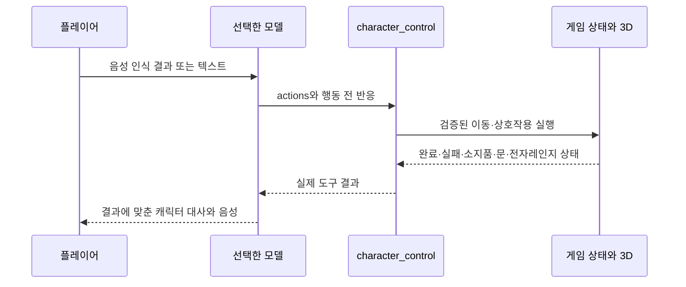

# 채널 07 · 퇴근하려면 살아남으세요

[웹게임 실행](https://d3q7tlfor72b22.cloudfront.net/channel07/)

CCTV를 보며 한국어 무전으로 3D 캐릭터 지우를 안내하는 코미디 탈출 게임입니다. 기존 차량 데모의 모델 목록과 차량 명령 점수를 재사용하며, 높은 점수순으로 판단·대화 모델을 선택할 수 있습니다. 음성 입력은 Whisper, 목소리는 Polly Seoyeon을 공통으로 사용합니다. S2S 모델을 선택해도 이 게임의 현재 입력·출력은 공통 ASR/TTS이며 네이티브 음성 간 비교가 아닙니다. 게임의 문·이동·소지품은 별도 실행기가 관리합니다. 캐릭터와 배경은 Three.js 기하 모델로 실제 렌더링하며, 생성한 콘셉트 이미지를 게임 배경으로 사용하는 방식이 아닙니다. 첫 버전은 단순화한 3D 외형입니다.

## 플레이

1. 시작 화면에서 모델을 고른 뒤 **무전 연결하기**를 누릅니다.
2. 마이크를 한 번 눌러 녹음을 시작하고, 다시 눌러 전송합니다. 텍스트 입력도 같은 모델과 실행기를 사용합니다. 녹음은 최대 25초입니다.
3. CCTV 버튼으로 탕비실·복도·자료실·전체 배치를 봅니다. 화면 속 물건을 클릭하면 다음 지시의 “저거”에 참고할 대상을 선택합니다. 클릭만으로 물건을 사용하지는 않습니다.
4. **멈춰** 버튼 또는 짧은 “멈춰” 음성 지시로 진행 중인 동작과 후속 행동을 취소합니다. 음성 정지는 ASR 후 처리되므로 긴급 중지는 화면 버튼이 가장 빠릅니다.
5. 상단에서 **모델 선택 → 대화·행동 판단**을 바꿉니다. 현재 판은 유지합니다. 차량 점수는 차량 시험 결과이며 게임 점수가 아닙니다. 공유 GPU 모델은 첫 로딩에 수십 초가 걸릴 수 있고, 현재 모델과 다른 모델을 선택한 다른 사용자의 요청은 로딩 비용을 만들 수 있습니다. 진행 상태를 표시하며 **멈춰** 또는 새 지시로 취소할 수 있습니다.
6. **처음부터**를 누르면 새 판을 시작합니다. 같은 브라우저의 이전 사건 기억은 유지합니다.

화면 안내는 한국어로 직접 작성하며, 지우의 대사에는 구체적인 한국어 말투 예시를 공통으로 전달합니다. 행동 후에는 실제 결과와 최근 물건 사용 기록도 함께 전달합니다. 그래도 모델별 한국어 표현력 차이는 남습니다. 차량 명령 점수와 게임 명령 통과 수는 자연스러운 대화 품질 점수가 아닙니다. 짧은 한국어 대화 확인에서는 Sonic 쪽이 더 자연스러웠고, Qwen 4B에는 어색한 질문이나 추측이 남아 있습니다. 게임 도중에도 두 모델을 바꿔 비교할 수 있습니다.

## 예시 진행 · 스포일러

- “안내문 읽어봐.”
- “바나나를 집어서 출입문에 대봐.” → 실패하지만 실제로 시도하고 사건을 기억합니다.
- “커피 다시 내려놔.” → 현재 방의 테이블/책상에 내려놓습니다. “바닥에 내려놔”, “테이블 위에 올려놔”처럼 목적지도 지정할 수 있고, 놓인 자리에서 다시 집을 수 있습니다.
- “바나나를 전자레인지에 넣어.” → 필요한 집기와 문 열기까지 수행합니다. “문 닫고 데워줘”, “문 열어”, “바나나 다시 꺼내”도 가능합니다. 넣기만 요청하면 가열하지 않습니다.
- “뒤로 두 발자국 가봐.” → 지우가 보는 방향 기준으로 약 1.1m 이동합니다. 벽·가구·잠긴 문에 막히면 이유를 보여줍니다. “왼쪽으로 돌아봐”로 방향을 바꿀 수 있습니다.
- “커피를 집어서 출입문에 사용해봐.” → 뜨거운 음료 안전 규정으로 문이 열립니다.
- “박주임한테 팀장님이 프린터 고장났으니 점검하래.” → 일정 시간 경비 로봇이 자리를 비웁니다.
- “청소도구함에 숨어.” 또는 “자료실에서 결재 도장 챙겨.”
- “기밀 문서도 가져와.” → 선택 목표, 엔딩 변경.
- “도장을 퇴근 게이트에 사용해.”
- “출근 단말기 눌러봐.”
- “퇴근 게이트 열어.”

경비 로봇에 가까이 가서 발각되면 6초 보안교육 후 도구함에서 다시 진행할 수 있습니다. 사망이나 전면 초기화는 없습니다. 새로운 행동 지시는 이전 행동을 대체합니다. 질문만 하는 경우에는 기존 이동을 중단하지 않습니다.

## 모델과 실행기

음성 → Whisper → 선택 모델의 판단·캐릭터 도구 호출 → 서버 검증 → 3D 이동·상호작용 → 실제 결과를 같은 모델에 반환 → 모델이 만든 지우의 대사 → Polly 음성.

- `/api/game/*`는 차량 세션·상태와 분리되어 있습니다. 차량의 온도 제어기에 게임 명령을 보내지 않습니다.
- L4의 Qwen3.5-4B vLLM과 Nova 2.5 Sonic은 네이티브 함수 호출을 사용합니다. HF 기반 차량 워커는 JSON 스키마로 함수 인자를 생성하는 어댑터를 사용합니다. 모든 모델이 네이티브 함수 호출 API를 제공한다고 표시하지 않습니다.
- 도구에는 상대 이동·방향 전환·조사·집기·놓기/넣기·열기·닫기·전자레인지 작동·숨기·경비 유인·대기·멈춤이 있습니다. 모델은 한 호출에서 최대 네 가지 행동을 결정합니다. 실행 결과를 읽고 원래 요청에서 빠진 행동이 있으면 추가 도구 호출을 이어갑니다. 자동 후속 호출은 최대 3단계·총 8개 요청 동작으로 제한하고 동일 동작의 반복을 차단합니다. 실행기는 실제 규칙과 경로만 처리합니다. 예를 들어 잠긴 문을 모델이 성공했다고 말해도 열리지 않습니다.
- 게임 실행기의 완료·실패 문장은 진단용 결과입니다. 행동 전 예상 대사는 음성·대화창에 내보내지 않아 완료 전 성공 주장과 중복 확인을 피합니다. 캐릭터의 일반 행동 완료 음성은 결과를 받은 **같은 모델이 생성**합니다. 모델 응답이 늦거나 실패하면 실행 결과와 대사 오류를 구분해 표시합니다. 세계의 안내 방송과 경비 로봇 대사는 고정되어 있습니다.
- 자유 대화에서는 행동 배열이 비어 있습니다. “나 때문에 고생이지?”에 엉뚱한 동작을 강제로 붙이지 않습니다. 새 목표를 정하거나 행동의 조합을 고르는 판단은 모델의 역할이며, 임의 행동을 실행했다고 지어내는 것은 허용하지 않습니다.
- 모델의 숨겨진 추론 내용을 노출하는 UI는 없습니다. 화면에는 인식한 말·요청한 행동·실제 실행 결과를 표시합니다.
- 입력 예시를 가짜 과거 대화로 넣던 구성을 제거했습니다. 예시를 이미 수행한 행동으로 착각하는 오류를 줄이기 위해 사용법 예시와 현재 세계 상태를 명확히 구분합니다. 후속 추론에서는 원래 사용자 지시를 새 메시지로 중복 전송하지 않고 실제 도구 결과만 전달합니다. “이미 했는데 또 시켜?” 같은 잘못된 반복 해석을 줄이기 위한 구성입니다.

### 기존 차량 모델 연결 범위

선택 목록은 `model-catalog.json`에서 생성한 별도 `game-model-catalog.json`을 읽고 차량 명령 점수로 정렬합니다. compact 차량 페이지의 전용 카탈로그를 덮어쓰지 않습니다.

- 자체 GPU: Qwen3.5 4B BF16/NF4, Qwen3.5 2B/0.8B, Gemma 4 E2B, Phi-4 mini, SmolLM3, EXAONE 4.0 1.2B, HyperCLOVA X 0.5B.
- 기존 음성 모델의 텍스트 판단 경로: Qwen3-Omni, MiniCPM-o 4.5, Step-Audio 2 mini. 한국어 음성 입출력은 공통 Whisper/Polly입니다.
- 관리형: Nova 2.5 Sonic의 함수 호출·텍스트 대화. 이 게임에서는 네이티브 음성 스트리밍 대신 공통 음성 경로로 비교합니다.
- MiMo와 Moshi는 현재 게임 어댑터가 없어 비활성 표시합니다. 라이선스 접근이 필요한 PersonaPlex와 미배포 GLM을 연결된 모델로 표시하지 않습니다.

차량에서 높은 제어 점수를 받은 모델이어도 게임의 자유 대화가 자연스럽다는 뜻은 아닙니다. 작은 모델은 요청 누락·어색한 반말·상태에 없는 부연을 만들 수 있습니다. 게임 점검과 자연스러움 평가는 구분합니다.

## AgentCore Memory

사용자는 무작위 HttpOnly 쿠키로 구분하며, 다른 사용자의 세션 토큰만으로 상태나 음성에 접근할 수 없습니다. AWS 키는 브라우저에 전달하지 않습니다.

- 로컬 사건 인덱스는 검증된 바나나 실패, 책임 약속, 탈출 결과를 즉시 보존합니다. 기본 경로는 `.runtime/channel07-memory.json`입니다.
- AgentCore `CreateEvent`로 실제 지시와 실행 결과를 비동기 저장합니다. 장기 semantic memory는 플레이어별 `/channel07/{actorId}/facts` 네임스페이스로 검색합니다.
- 장기 기억 추출은 비동기이므로 즉각적인 재시작 대사는 로컬 인덱스를 함께 사용합니다. 게임의 문 잠금이나 현재 소지품을 장기 기억으로 판단하지 않습니다.
- UI는 AgentCore 연결 상태와 로컬 보존 상태를 구분해 표시합니다. 클라우드 메모리가 일시적으로 실패해도 게임은 진행됩니다.
- 현재 기억 항목은 바나나 사건·책임 약속·탈출입니다. 임의의 별명 추출과 장기 관계 변화는 아직 구현하지 않았습니다.

## 실행과 배포

`npm ci` 후 `npm start`로 실행합니다. `/channel07/`에 접속합니다. 3D 화면은 WebGL을 지원하는 브라우저가 필요하고 마이크는 HTTPS 또는 localhost에서 사용할 수 있습니다.

기본 게임 판단 모델은 로컬의 OpenAI 호환 vLLM `vehicle-planner` 엔드포인트를 사용합니다. Qwen3.5는 `--enable-auto-tool-choice --tool-call-parser qwen3_coder`가 필요합니다. [vLLM 공식 Qwen3.5 실행 예시](https://recipes.vllm.ai/Qwen/Qwen3.5-9B)의 함수 호출 설정을 참고합니다. 기본 `GAME_LLM_URL=http://127.0.0.1:8000/v1/chat/completions`. Whisper와 Polly 설정은 기존 서버 설정을 따릅니다. GPU가 연결되지 않은 컴퓨터에서도 3D 화면은 열리지만 자유 음성 명령은 동작하지 않습니다.

선택 환경 변수:

- `GAME_MEMORY_ID`: AgentCore Memory 리소스 ID. 생략하면 로컬 사건 기록만 사용.
- `GAME_MEMORY_REGION`: 기본 `ap-northeast-1`.
- `GAME_MEMORY_FILE`: 로컬 사건 인덱스 경로.
- `GAME_LLM_URL`: 게임용 vLLM chat completions 주소.
- `GAME_CORE_URL`: 기존 차량 HF 워커의 VPC 전용 게임 브리지.
- `GAME_SPEECH_URL`: 기존 음성 워커의 VPC 전용 게임 브리지.
- `GAME_SONIC_ENABLED=1`: 기존 Bedrock 역할의 Sonic 접근 권한을 재사용합니다.

`infra/provision_game_memory.py --runtime-role <EC2 역할 이름>`으로 게임 전용 메모리와 제한된 IAM 권한을 구성할 수 있습니다. `scripts/deploy-channel07.py`는 기존 compact 서버에 SSM과 private S3 임시 번들로 배포합니다. `.env`나 개발자 자격 증명은 번들에 포함하지 않습니다. 웹 번들 배포는 웹 백엔드만 재시작합니다. `scripts/deploy-channel07-models.py`는 기존 차량·음성 워커에 게임 전용 스키마와 브리지를 추가하며 해당 워커를 재시작합니다. 브리지는 private IP에 바인딩하고 게임 웹 서버의 보안 그룹만 접근시킵니다. 차량의 기본 스키마는 유지합니다. `scripts/enable-game-vllm-tools.py`는 기존 L4에서 실행하는 함수 호출 설정 보완 스크립트이며 실패 시 기존 컨테이너로 되돌립니다. 새 GPU를 생성하지 않습니다. CloudFront의 `/channel07/*` 경로는 배포 후 무효화해야 합니다.

## 검증 범위

`npm test`에 게임 실행 규칙·취소·사용자 격리·기억 보존 시험이 포함됩니다. `node scripts/channel07-smoke.mjs`는 실제 모델이 제안한 행동으로 바나나 시도부터 탈출과 다음 판의 기억까지 검사합니다. `GAME_TEST_AUDIO=<WAV 경로>`를 지정하면 한국어 음성 입력부터 문 열기까지 추가 검사합니다. 합성 음성 시험은 실제 사람의 마이크·소음 환경 인식률 검증을 대신하지 않습니다.

첫 버전은 데스크톱 브라우저 중심의 짧은 프로토타입입니다. 같은 GPU의 차량 데모와 추론 자원을 공유합니다. 페이지 새로고침이나 서버 재시작 후에는 새 판으로 연결하며, 사건 기억은 유지합니다. 긴급 음성 끼어들기, 자유 물리 조작, 실시간 S2S, 전문 캐릭터 에셋·모션 캡처, 모바일 장시간 성능 시험은 포함하지 않습니다.

## 첫 배포 실측

[검증 기록](../research/channel07-validation.json): 실제 Qwen 모델의 8단계 명령으로 바나나 시도·문 열기·경비 로봇 유인·도장과 기밀 문서 회수·결재·출근·탈출을 통과했습니다. 이 짧은 스모크 시험의 판단 시간은 약 1.03~2.05초였습니다. 전체 게임의 인식률 벤치마크가 아닙니다.

합성 한국어 음성의 “지우야 커피를 집어서 출입문에 사용해봐”는 ASR 약 142ms, 판단 약 1.61초, 서버 응답 약 1.76초로 문 열기까지 연결됐습니다. 이 시간은 녹음·캐릭터 이동 완료·음성 재생 시간을 포함하지 않습니다. AgentCore에 실제 이벤트 저장 및 장기 기억 검색을 별도로 확인했습니다.

내려놓기 추가 검증: [실제 모델 시험 8건](../research/channel07-put-validation.json)에서 문을 연 뒤 커피 내려놓기, 재획득, 다른 방의 책상 위 배치, 바닥 배치와 재획득을 확인했습니다. 내려놓은 위치가 게임 상태와 3D 화면에 반영됩니다. 이미 열린 문이나 승인된 결재는 소지품을 내려놓아도 취소되지 않습니다.

## 모델 비교 점검

`node scripts/channel07-model-smoke.mjs`는 뒤로 두 발자국, 바나나 전자레인지 넣기·꺼내기·내려놓기, 잡담에서 행동하지 않기, 커피로 문 열기의 6가지 명령을 실제 배포 모델로 실행합니다. `GAME_TEST_MODELS`로 모델 ID 목록을 지정할 수 있습니다. 측정에는 모델 로딩을 별도로 표시하고, 판단 시간과 이동·후속 대사까지의 전체 시간을 구분합니다. 이 소수 고정 명령의 통과율을 자유 한국어 인식률이나 주관적인 대화 품질 점수로 해석하면 안 됩니다.

[실제 모델별 점검 기록](../research/channel07-model-validation.json)을 참고하세요. 선택창의 체크는 이 게임 스모크 전 항목 통과를 의미합니다. 미측정 모델에는 게임 점수를 만들지 않습니다.

## 정답 대신 실험을 안내하는 도구

`GET /api/game/tools`는 실제 모델에 전달하는 함수 스키마를 반환합니다. `GET /api/game/capabilities`와 `character_control`의 `help` 동작은 같은 서버 행동 목록을 읽습니다. 별도 MCP 서버를 거치지 않는 로컬 함수 호출입니다. `help`는 읽기 전용이라 진행 중인 이동이나 소지품을 바꾸지 않습니다. 응답은 이동·조사·물건 실험·시설 조작·상황 대응의 다섯 묶음, 실제 대상별 가능한 조작, 아직 지원하지 않는 동작을 포함합니다. 화면의 **할 수 있는 행동**도 이 목록을 표시합니다.

- “푸쉬업 열 개 해봐.” → 실행한 척하지 않고 아직 못 하는 동작임을 말하며, 가능한 행동을 알려줄지 물어봅니다. 사용자가 동의하면 행동 조회 도구로 선택지를 확인합니다.
- “어떤 물건으로 문을 열어볼까?” → 정답을 먼저 정해주지 않고 보이는 물건을 조사하거나 다른 조건·조합을 시험하도록 제안합니다.
- 목표·추천 문장·첫 안내에서 커피와 도장 등 정답 순서를 제거했습니다. 안내문을 직접 읽고 발견하는 단서는 남아 있습니다. 사용자가 명시적으로 정답을 요청하면 더 직접적인 도움을 받을 수 있습니다.
- 각 물건에는 **조사**, **문에 사용해보기**, **전자레인지에 넣기** 같은 실험 선택지가 표시됩니다. 성공을 보장하는 버튼이 아닙니다.
- **시도한 조합**에는 실제로 대상을 사용해본 결과만 남습니다. 실패도 다음 선택의 단서가 되며, 모델의 추측이나 행동 전 대사를 성공 기록으로 저장하지 않습니다.

모델의 자유 문장은 언제나 완벽하지 않습니다. “정답을 먼저 말하지 않기”와 지원하지 않는 행동에 대한 말투는 실제 모델 대화로 따로 점검하며, 세계의 변화는 서버 도구 결과만 결정합니다.

### 행동 도구 계약

| 동작 | 도구 인자 | 실행 범위 |
|---|---|---|
| 가능한 행동 조회 | `help`, 대상 또는 빈 문자열 | 읽기 전용. 현재 가능한 행동·물건·제한을 반환 |
| 이동·방향 | `move`, `step`, `turn` | 대상까지 이동, 몸 기준 1~5발자국, 방향 전환 |
| 조사 | `inspect` | 대상의 실제 현재 상태와 발견한 단서를 반환 |
| 집기·놓기·넣기 | `take`, `put` | 소지품과 3D 배치를 실제 변경 |
| 조합 시험 | `use` | 물건을 다른 대상에 사용. 성공/실패를 실제 규칙으로 판단 |
| 시설 | `open`, `close`, `activate` | 문·시설 조작과 전자레인지 작동 |
| 상황 대응 | `hide`, `distract`, `wait`, `stop` | 숨기, 경비의 주의 돌리기, 대기, 즉시 취소 |
| 화면 | `camera` | CCTV 시점 변경 |

지원하지 않는 동작을 모델이 JSON에 넣어도 검증기가 실행하지 않습니다. 새 행동을 추가할 때는 스키마, 서버 실행 규칙, 3D 표현, 이 능력 목록을 함께 연결해야 합니다.

**조언만 받기**를 선택한 입력과 **다음 실험 고민하기** 버튼은 서버가 읽기 전용 `help`를 먼저 호출합니다. 선택한 모델은 그 결과로 제안만 생성하고 캐릭터 제어 도구를 실행할 수 없습니다. 일반 지시 입력은 모델이 필요한 행동을 고르며, 조언 모드 체크를 해제하면 다시 행동을 시킬 수 있습니다.

실측 모델별 표는 [선택창용 요약](../public/channel07/model-evaluation.json)과 [원시 게임 점검 기록](../research/channel07-model-validation.json)에 저장합니다. `scripts/update-channel07-evaluation.py <스모크 결과 JSON...>`으로 완료된 6개 명령 시험을 갱신할 수 있습니다. 체크 표시는 실험 추천이며, 차량 점수 순서는 유지합니다.

### 이번 직접 명령 실측

아래는 고정 6개 명령의 상태 확인 결과입니다. 대화의 재미나 자연스러움 점수는 아닙니다. 판단 API 중앙값은 모델 로딩이 없는 요청을 사용하며 공유 GPU의 대기 시간이 포함됩니다. 이동·후속 대사 시간은 제외합니다.

| 모델 | 제어 점검 | 판단 API 중앙값 | 관찰 |
|---|---:|---:|---|
| Gemma 4 E2B · L40S HF | 6/6 | 1.50초 | 직접 명령은 통과. 질문을 명령으로 해석한 사례가 있어 조언 모드를 사용하세요. |
| Phi-4 mini · L40S HF | 5/6 | 0.92초 | 명령 누락과 어색한 한국어 샘플이 있었음. |
| Qwen3.5 4B NF4 · L40S HF | 6/6 | 2.47초 | 제어 비교용. 말투가 반복적인 샘플이 있었음. |
| MiniCPM-o 4.5 · L40S | 4/6 | 2.05초 | 초기 측정값. 이후 대사 형식 보정이 들어갔으며 재검증 필요. |
| Qwen3.5 4B BF16 · L4 vLLM | 6/6 | 2.60초 | 기본 제어 비교용. 자연스러운 조언은 조언만 받기 모드를 사용하세요. |
| Nova 2.5 Sonic · Bedrock | 6/6 | 0.91초 | 이번 짧은 실험에서 한국어 선택지 안내가 가장 자연스러웠음. 공통 Whisper/Polly 경로. |

[조언·미지원 행동 실제 대화 기록](../research/channel07-guidance-validation.json)에는 푸쉬업 거절, 능력 조회, 정답 대신 후보 제안, 실패한 조합 뒤 다음 실험 제안이 들어 있습니다. 읽기 전용 조언 입력이 실제 물건이나 문을 바꾸지 않았는지도 확인했습니다.
