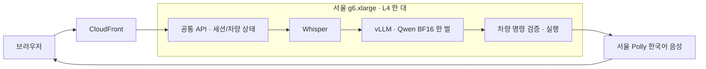

# L4 한 대로 차량 음성 서비스를 효율적으로 쓰는 방법

**이번 시험에서는 서울 L4 한 대에 Whisper와 Qwen3.5-4B BF16을 함께 올리고, Qwen은 vLLM으로 서빙하는 구성을 선택했습니다.** 응답 음성은 서울 Polly Neural입니다. 다른 GPU 서버로 옮겨 비교한 추정치가 아니라, 실제 `g6.xlarge` 한 대에서 차량 상태 변경과 음성 수신까지 확인한 결과입니다.

[선택한 구성 직접 테스트](https://d3q7tlfor72b22.cloudfront.net/?lang=ko) · [비용 계산기·전체 실측표](https://d3q7tlfor72b22.cloudfront.net/costs.html) · [원본 JSON](../research/rightsizing-l4/summary.json) · [영문 측정·배포 안내](GPU_RIGHTSIZING.md)

## Docker를 여러 개 띄우면 빨라질까?

가능하지만 이번 시험에서는 이득이 없었습니다. 같은 GPU에 같은 모델 두 벌을 올리면 가중치와 CUDA 컨텍스트가 중복되고, GPU·CPU 자원을 나눠 씁니다. 별도 GPU 두 대를 얻는 것과 다릅니다. 각 복제본으로 실제 요청이 나뉘었음을 요청 카운터로도 확인했습니다.

vLLM은 **가중치를 한 벌 적재하고 여러 요청을 연속 배치로 처리**합니다. 같은 Phi 모델로 세 가지 서빙 방식을 먼저 비교했고, 정확도가 더 높았던 Qwen을 별도 후보로 추가 검증했습니다. 아래는 각 구성에서 동시 요청 8개, 녹음 명령 24건을 보낸 결과입니다.

| 모델과 서빙 방식 · 모두 L4 한 대 | 31개 공통 차량 명령 | 성공 처리량 | 첫 음성 p95 |
| --- | --- | --- | --- |
| Phi / HF 워커 1개 | 29/31 | 0.681건/초 | 11.90초 |
| Phi / Docker 워커 2개 | 29/31 | 0.661건/초 | 13.23초 |
| Phi / vLLM 1개 | 28/31 | 2.393건/초 | 4.66초 |
| Qwen 4B BF16 / vLLM 1개 | 30/31 | 2.405건/초 | 4.20초 |

Phi끼리 비교하면 vLLM의 처리량은 HF 단일 워커의 약 3.5배였습니다. 다만 Phi의 차량 명령 통과 수가 한 개 줄어 정확도도 고려했습니다. 최종 Qwen 구성은 공통 시험 30/31, 첫 음성 중앙값 1.21초였고, 동시 요청 4개에서는 1.865건/초·p95 2.64초였습니다. 네 구성의 부하 요청은 각각 96/96건 모두 상태 변경과 음성 출력에 성공했습니다. 이 부하 시험의 여섯 명령은 31개 공통 품질 시험과 별도입니다.

이 수치는 **짧은 한국어 합성 녹음·신규 세션·반복 명령·워밍업 후** 결과입니다. 첫 음성은 파일 제출/세션 생성부터 첫 오디오 수신까지이며 개발자와 서울 사이 SSH 왕복을 포함합니다. 실제 마이크 발화 종료 감지, 차량 주행 소음, 브라우저 재생 지연, 장시간 대화, 운영 최대 용량이나 SLA를 검증한 수치는 아닙니다. vLLM의 공통 프롬프트 캐시도 이 반복 시험에 유리하게 작동합니다.

Qwen의 남은 실패는 Whisper가 ‘길 안내 종료’를 ‘기회 안내 종료’로 인식한 사례입니다. 차량 제어 연결이 빠진 문제가 아닙니다. Phi는 목적지 설정을 실행하지 않고 재질문하는 사례도 있었습니다. 전체 실패의 인식문·응답·기대/실제 명령을 비용 페이지에서 펼쳐 볼 수 있습니다. HF와 vLLM의 Qwen 입력 토큰 657개가 동일한지도 직접 확인했습니다.

4비트가 항상 빠른 것도 아니었습니다. HF Qwen BF16과 NF4는 모두 30/31이었지만 첫 음성 중앙값은 BF16 1.58초, NF4 2.02초였습니다. NF4는 판단 모델 적재를 약 8.46GiB에서 3.08GiB로 줄였습니다. 메모리를 아끼는 것과 이 GPU에서 지연을 줄이는 것은 다른 목표입니다.

## 서로 다른 모델도 한 장비에 들어갈까?

이미 이 배포에서 Whisper와 Qwen이 같은 L4를 씁니다. 서로 다른 기본 모델을 더 추가하는 것도 가능하지만 가중치, KV 캐시, CUDA 컨텍스트와 동시 요청의 최대 메모리를 모두 합쳐야 합니다. 모든 조합을 시험한 것은 아닙니다. 일반적인 vLLM 엔진 하나가 임의의 여러 기본 모델을 자동 배치·선택하는 것은 아닙니다.

vLLM은 KV 캐시를 미리 예약하므로 GPU 총 사용량이 단일 HF보다 커 보일 수 있습니다. ‘GPU 사용 메모리가 적다’만으로 효율을 판단하지 않고, 정확도·지연을 지킨 성공 처리량을 함께 봐야 합니다. 같은 GPU의 컨테이너는 고정 메모리/연산 할당으로 격리한 구성이 아닙니다. 이번에는 MIG나 MPS를 사용하지 않았습니다.

## 손익분기점은 언제일까?

- L4 `g6.xlarge`: **$0.9896/시간, 730시간이면 월 약 $722.41**.
- Polly: 응답 20문자 가정 시 명령당 약 $0.00032.
- Sonic 2.5: 새 세션의 입력 5.12초·출력 3.04초 예시 1건의 토큰 사용량으로 **약 $0.002713/건**을 추정. 대화 평균이나 실제 청구서가 아닙니다. 한국어는 Sonic 공식 지원 언어가 아니므로 품질 동등성을 뜻하지 않습니다.
- 한 대를 계속 켜는 구성의 계산상 교차점: **월 약 30.2만 건, 하루 약 1만 건**. 두 대를 상시 켜면 약 60.4만 건으로 올라갑니다. 같은 서버에 컨테이너 두 개를 띄워도 인스턴스 고정비는 한 대분입니다.

| 월 명령 수 | L4 한 대 + Polly | Sonic 예시 추론비 |
| --- | ---: | ---: |
| 10,000 | $725.61 | $27.13 |
| 100,000 | $754.41 | $271.32 |
| 300,000 | $818.41 | $813.96 |
| 1,000,000 | $1,042.41 | $2,713.19 |

공통 웹서버, EBS, CloudFront/트래픽, 외부 도구, 운영 인력, 세금과 할인은 제외했습니다. 기존 공유용 L40S는 계속 실행 중이므로 실제 계정 비용에는 새 L4 비용도 추가됩니다. 월 요청 수만으로 필요한 서버 수를 확정할 수 없으며 피크 도착률과 지연 목표를 함께 봐야 합니다. 가격 확인은 2026-10-22 AWS Price List API 기준입니다.

공개 CloudFront 주소의 브라우저에서도 조수석 25도 음성 명령과 운전석 24도·바람 3단 복합 명령을 확인했습니다. 워밍업 후 음성 요청의 실제 브라우저 첫 재생은 1.256초였습니다. 컨테이너 재시작 직후 첫 요청은 7.54초였으므로 배포 스크립트가 공유 전에 실제 합성 음성 명령으로 전체 경로를 미리 준비하도록 했습니다. 단일 스모크 측정과 위 분포 시험은 구분해야 합니다.

## 그럼 스케일은 어떻게 할까?

**작은 L4 한 대를 따뜻하게 유지 → 한 모델은 vLLM으로 동시 처리 → 큐 지연과 응답 p95가 지속해서 늘 때 GPU 서버를 추가**하는 순서를 권합니다. 공통 API가 세션과 차량 상태를 보관하고, 상태 없는 추론 워커만 늘리면 대화가 복제본 사이에서 섞이는 것을 피할 수 있습니다. 현재도 차량 상태는 공통 Node API가 관리합니다.

vLLM이 EC2를 자동으로 만들거나 줄여 주지는 않습니다. ECS/Kubernetes/SageMaker 또는 별도 오토스케일러가 그 역할을 맡아야 하며, **이번 배포에는 EC2 자동 증설이 설정되어 있지 않습니다.** 준비된 GPU 용량 하나가 내려가도 서비스가 유지되려면 별도 장비가 추가로 필요하며 그 비용도 반영해야 합니다. 최초 모델/커널 준비에 수 분이 걸린 것을 확인했으므로 음성 서비스의 scale-to-zero는 지연 목표와 함께 신중히 판단해야 합니다.

T4 `g4dn.xlarge`는 서울 $0.647/시간으로 더 저렴하지만 FP16/런타임 변경이 필요해 이번에 실측하지 않았습니다. L4의 BF16 수치를 그대로 옮겨 계산하면 안 됩니다. `g6.2xlarge`는 같은 L4에 CPU/RAM이 더 많고 $1.20208/시간이며 이것도 미실측입니다. 다른 서버가 전역 최적이라는 결론까지 내린 시험은 아닙니다.
